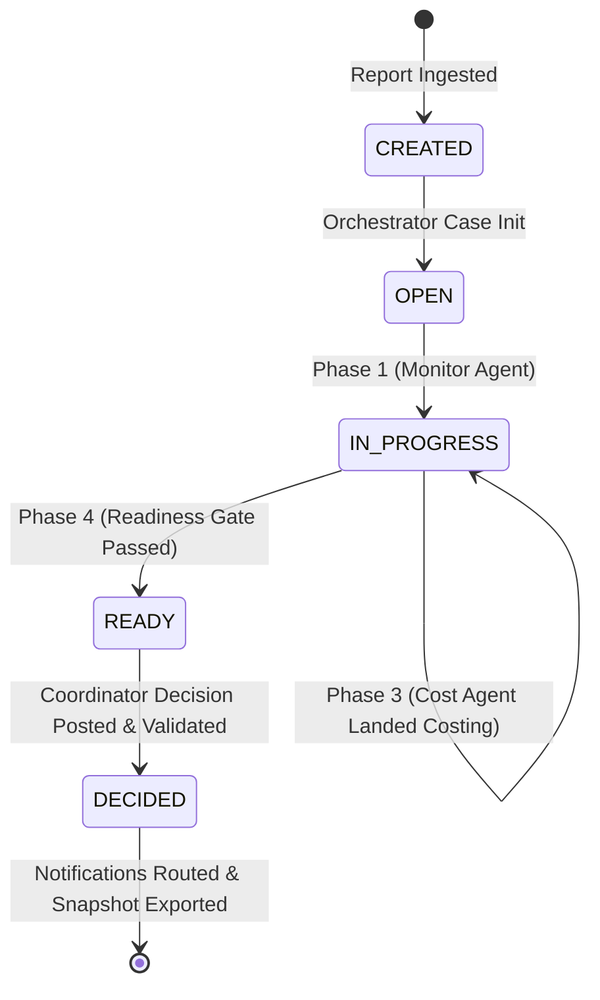

# Supply Chain Disruption Response Coordinator (SCDRC)
## System Architecture Specification

---

## 1. Executive Summary

The **Supply Chain Disruption Response Coordinator (SCDRC)** is an enterprise-grade multi-agent autonomous mitigation system built using **LangChain**, **LangGraph**, **FastAPI**, **Streamlit**, and **SQLite/ChromaDB**. 

When supply chain disruptions occur—such as supplier cleanroom contamination, expressway rockslides, or sudden regional stockouts—the system coordinates six autonomous specialist agents through an explicit, compiled **LangGraph StateGraph** over a centralized **Blackboard Architecture** to determine the optimal, cheapest viable operational mitigation (**REORDER**, **REROUTE**, or **HOLD**).

---

## 2. Architectural Principles

1. **Strict Blackboard Pattern (Shared State):**
   Agents communicate *exclusively* by posting typed, immutable signals to a centralized `Blackboard`. No agent ever directly invokes or communicates with another agent.
2. **Grounded Decisions (Zero Hallucination):**
   The final mitigation decision generated by the `Coordinator Agent` must cite only verified Blackboard entry IDs and factual quantities present on the board. The `GroundingValidator` programmatically inspects and enforces citations before a decision can be persisted.
3. **Cheapest Viable Mitigation (Group-of-3 Cost Agent):**
   A dedicated `Cost Agent` models comprehensive total landed costs (purchase, freight, expedite fees, holding cost, and stockout penalty) across all candidate actions, guaranteeing cost-optimal decision making.
4. **Resilient Degradation:**
   If any specialist agent encounters timeouts or upstream failures, the Orchestrator posts a `DEGRADED` signal, allowing downstream agents to safely fall back to conservative actions (e.g., HOLD with human escalation) rather than crashing the pipeline.

---

## 3. Logical Architecture & Flow

```
                      Disruption Report (Text / JSON / API / UI)
                                         │
                                         ▼
                            ┌────────────────────────┐
                            │      Orchestrator      │
                            │  (Deterministic Engine)│
                            └───────────┬────────────┘
                                        │ Initializes
                                        ▼
    ┌────────────────────────────────────────────────────────────────────────┐
    │                       SHARED BLACKBOARD STATE                          │
    │   case_id · status · entries[] · audit_log · versioning · views        │
    └───▲─────────────▲─────────────▲─────────────▲─────────────▲────────▲───┘
        │             │             │             │             │        │
   ┌────┴───┐    ┌────┴────┐   ┌────┴────┐   ┌────┴────┐   ┌────┴───┐ ┌──┴────────┐
   │Monitor │    │Inventory│   │Supplier │   │ Route   │   │ Cost   │ │Coordinator│
   │ Agent  │    │ Agent   │   │ Agent   │   │ Agent   │   │ Agent  │ │   Agent   │
   └────┬───┘    └────┬────┘   └────┬────┘   └────┬────┘   └────┬───┘ └───┬───────┘
        │             │             │             │              │         │
        ▼             ▼             ▼             ▼              ▼         ▼
    Groq/Mock    SQLite WMS     SQLite +      SQLite +        Economic   Grounding
       LLM        Database      ChromaDB      ChromaDB         Model     Validator
                                (Contracts)   (Advisories)                 Gate
                                                                           │
                                                                           ▼
                                                                  Notification Router
                                                                           │
                                                                           ▼
                                                              Stakeholder Outbox (Email/SMS)
```

---

## 4. Execution Phases & State Machine

The Orchestrator governs execution through 5 sequential phases:



### Phase Protocol

| Phase | Knowledge Worker | Trigger Event | Inputs Read | Output Posted to Blackboard |
|---|---|---|---|---|
| **Phase 0** | **Orchestrator** | Disruption Report Ingestion | Raw text / Webhook | Initial `Blackboard` state (`status=OPEN`) |
| **Phase 1** | **Monitor Agent** | `status=OPEN` | Raw Disruption Report | `DISRUPTION_PROFILE`, `AFFECTED_ITEMS`, `AFFECTED_SITES` |
| **Phase 2** | **Inventory Agent** | `AFFECTED_ITEMS` present | Master DB, Items, Sites | `INVENTORY_STATUS` (on-hand, safety stock, days of cover) |
| **Phase 2** | **Supplier Agent** | `AFFECTED_ITEMS` present | Supplier DB + ChromaDB Contracts | `SUPPLIER_OPTIONS` (lead times, prices, contract clauses) |
| **Phase 2** | **Route Agent** | `AFFECTED_SITES` present | Lane DB + ChromaDB Advisories | `ROUTE_OPTIONS` (modes, transit days, active route blocks) |
| **Phase 3** | **Cost Agent** | Supplier & Route options present | Cost Rates, Inventory Status | `COST_ESTIMATES` (itemized landed costs per candidate option) |
| **Phase 4** | **Coordinator Agent** | Readiness gate check (`READY`) | Complete Blackboard View | `DECISION` (chosen mitigation, rationale, cited entries) |
| **Phase 5** | **Notification Router** | `DECISION` posted | Stakeholder Directory, Decision | `NOTIFICATIONS` (Email/SMS outbox dispatch, snapshot save) |

---

## 5. Specialist Agent Roles

### 5.1 Monitor Agent
- **Responsibility:** Ingests unstructured disruption text, normalizes entity names against enterprise master catalogs, and establishes disruption severity and duration.
- **Tools:** LLM entity extractor, Master Data Catalog lookup.
- **Write Scope:** `DISRUPTION_PROFILE`, `AFFECTED_ITEMS`, `AFFECTED_SITES`.

### 5.2 Inventory Agent
- **Responsibility:** Evaluates stock health across all affected facilities. Computes exact on-hand stock, in-transit replenishment, safety stock buffer breaches, daily consumption rate, and days of cover.
- **Tools:** `SQLiteInventoryRepository` (`get_stock_status`, `get_daily_demand`).
- **Write Scope:** `INVENTORY_STATUS`.

### 5.3 Supplier Agent
- **Responsibility:** Discovers alternate pre-qualified suppliers, assesses factory capacity, minimum order quantities (MOQ), and queries contract terms via RAG. Enforces quality clauses (such as disqualifying probationary vendors).
- **Tools:** `SQLiteSupplierRepository`, `ChromaDB Contract Retriever`.
- **Write Scope:** `SUPPLIER_OPTIONS`.

### 5.4 Route Agent
- **Responsibility:** Maps alternative transit lanes (express road, freight rail, air cargo) between supplier hubs and distribution centers. Queries live weather and port advisories via RAG.
- **Tools:** `SQLiteLaneRepository`, `ChromaDB Advisory Retriever`.
- **Write Scope:** `ROUTE_OPTIONS`.

### 5.5 Cost Agent (Group-of-3 Feature)
- **Responsibility:** Models total landed costs for every mitigation option:
  $$\text{Total Cost} = \text{Purchase} + \text{Freight} + \text{Expedite} + \text{Holding Cost} + \text{Stockout Risk Penalty}$$
- Evaluates viability constraints (lead time vs days of cover, MOQ vs demand, route block status).
- **Tools:** `SQLiteCostRepository`, `CandidateOptionBuilder`, `ViabilityEngine`.
- **Write Scope:** `COST_ESTIMATES`.

### 5.6 Coordinator Agent
- **Responsibility:** Synthesizes the complete blackboard state, selects the cheapest viable mitigation option, constructs an evidence-grounded rationale citing specific Blackboard entries, and submits the decision to the Grounding Validator.
- **Tools:** `ScoringEngine`, `GroundingValidator`, LLM Rationale Synthesizer.
- **Write Scope:** `DECISION`.

---

## 6. Grounding and Verification Loop

To prevent LLM hallucination, the `GroundingValidator` enforces deterministic checks:
1. **Entry Citation Verification:** Every entry ID cited in `cited_entry_ids` must correspond to an existing record on the Blackboard.
2. **Option Id Match:** The chosen option must match an identified candidate on the Blackboard.
3. **Number Grounding:** Numerical metrics, costs, and lead times cited in the rationale must exist in the Blackboard entries.
4. **Repair Fallback:** If an ungrounded claim is detected, the validator substitutes a deterministic, proven rationale citing verified entries.

---

## 7. Storage and Persistence

- **Relational Data (SQLite):** Master catalogs (`items`, `sites`, `inventory`, `suppliers`, `lanes`, `cost_rates`, `contacts`) stored in `data/scdrc.db`.
- **Vector Data (ChromaDB):** 35 semantic document chunks across contracts, SOPs, and route advisories in `data/chroma_db/`.
- **Artifacts & Outbox:** Case snapshots and formatted email/SMS alerts persisted to `outputs/<case_id>/`.
