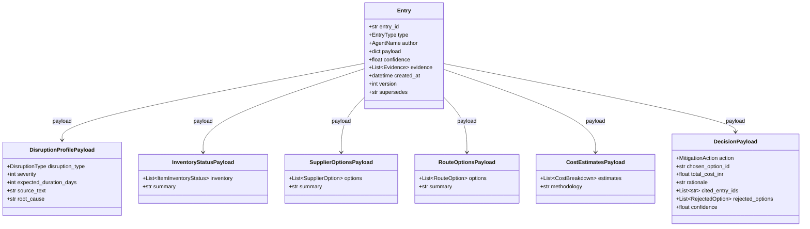

# Blackboard Specification & Coordination Protocol
## Supply Chain Disruption Response Coordinator (SCDRC)

---

## 1. Overview

The **Blackboard Pattern** is the central architectural coordination mechanism of SCDRC. In this pattern:
- The Blackboard is a shared, append-only structured state object representing a single disruption incident (`Case`).
- Specialist agents act as independent knowledge sources.
- Agents **never call each other**; they observe the blackboard state and post typed signals.
- The `Coordinator Agent` decides mitigation actions strictly using information posted to the Blackboard.

---

## 2. Blackboard State Schema

A `Blackboard` instance contains:
- `case_id`: Unique identifier (e.g. `CASE-20261115-125035`).
- `status`: Current lifecycle phase (`CREATED`, `OPEN`, `IN_PROGRESS`, `READY`, `DECIDED`, `FAILED`).
- `report`: Ingested disruption report metadata and raw text.
- `entries`: Ordered, append-only list of typed knowledge entries (`Entry`).
- `audit_log`: Chronological event trail tracking state transitions, agent locks, and write operations.
- `version`: Monotonically increasing sequence number incremented on every write.

```python
class Blackboard:
    case_id: str
    status: CaseStatus
    report: DisruptionReport
    entries: List[Entry]
    audit_log: List[AuditEvent]
    version: int
```

---

## 3. Entry Model

Every signal posted to the Blackboard follows the standardized `Entry` envelope:

| Field | Type | Description |
|---|---|---|
| `entry_id` | `str` | Sequential unique identifier (e.g., `E-0001`, `E-0002`). |
| `type` | `EntryType` | Enumerated entry category (e.g., `DISRUPTION_PROFILE`, `DECISION`). |
| `author` | `AgentName` | Originating specialist agent identity. |
| `payload` | `Dict[str, Any]` | Pydantic-validated domain payload. |
| `confidence` | `float` | Numerical agent certainty score ($0.0 \le c \le 1.0$). |
| `evidence` | `List[Evidence]` | Citations to database records, RAG documents, or raw text. |
| `created_at` | `datetime` | UTC timestamp of entry posting. |
| `version` | `int` | Monotonically increasing blackboard version at time of write. |
| `supersedes` | `Optional[str]` | Entry ID of an earlier entry replaced by this updated knowledge. |

---

## 4. Entry Types and Payload Definitions



### 4.1 Entry Types
1. `DISRUPTION_PROFILE`: Extracted incident taxonomy, duration, severity, and root cause.
2. `AFFECTED_ITEMS`: List of impacted SKUs, quantities at risk, and criticality.
3. `AFFECTED_SITES`: Impacted production plants and distribution hubs.
4. `INVENTORY_STATUS`: On-hand stock, in-transit units, safety stock threshold, and days of cover.
5. `SUPPLIER_OPTIONS`: Alternate suppliers, lead times, unit costs, capacities, and contract qualification.
6. `ROUTE_OPTIONS`: Alternative transit routes, operational status, and added delays.
7. `COST_ESTIMATES`: Itemized landed costs for REORDER, REROUTE, and HOLD options.
8. `DECISION`: Final mitigation action, chosen entity, rationale, and cited entry IDs.
9. `NOTIFICATIONS`: Generated stakeholder alerts dispatched to the outbox.
10. `DEGRADED`: Failure notice posted when an agent times out or crashes.

---

## 5. Strict Permission Matrix

To enforce separation of concerns, the Blackboard enforces a strict per-agent write permission matrix. Attempts by an agent to post an unauthorized entry type raise an `UnauthorizedWriteError`.

| Agent | Read Access | Allowed Entry Types to Write |
|---|---|---|
| **Monitor Agent** | Case Report | `DISRUPTION_PROFILE`, `AFFECTED_ITEMS`, `AFFECTED_SITES` |
| **Inventory Agent** | `AFFECTED_ITEMS`, `AFFECTED_SITES` | `INVENTORY_STATUS` |
| **Supplier Agent** | `AFFECTED_ITEMS` | `SUPPLIER_OPTIONS` |
| **Route Agent** | `AFFECTED_SITES` | `ROUTE_OPTIONS` |
| **Cost Agent** | `AFFECTED_ITEMS`, `INVENTORY_STATUS`, `SUPPLIER_OPTIONS`, `ROUTE_OPTIONS` | `COST_ESTIMATES` |
| **Coordinator Agent** | Full Blackboard | `DECISION` |
| **Notification Router** | `DECISION`, Full Blackboard | `NOTIFICATIONS` |
| **Orchestrator** | Full Blackboard | `DEGRADED`, Lifecycle Transitions |

---

## 6. Scoped Blackboard Views (`BlackboardView`)

Agents do not access the raw `Blackboard` instance directly; they interact through a `BlackboardView` scoped to their `AgentName`.

### Guarantees:
1. **Permission Check at Post:** Calling `view.post_entry(entry_type, payload)` validates that `entry_type` is in `AGENT_WRITE_PERMISSIONS[self.agent_name]`.
2. **Append-Only Immutability:** Entries cannot be deleted or mutated in-place. If knowledge is refined, a new entry is posted with `supersedes="E-XXXX"`.
3. **Lazy Asynchronous Concurrency:** Read and write operations acquire an asynchronous lock (`asyncio.Lock`), ensuring thread-safe concurrency when parallel agents post signals simultaneously during Phase 2.
4. **Complete Audit Trail:** Every write, read, and status transition automatically logs an `AuditEvent` with timestamp, agent name, and delta version.
